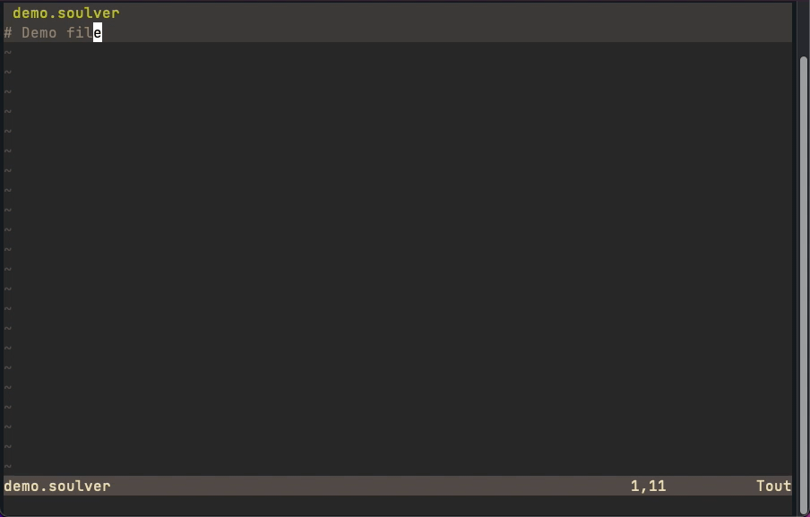

# soulver3.vim

soulver3.vim lets you use vim / neovim as a front end to [Soulver 3](https://soulver.app/)

# Demo




# Installation

```bash
$ brew install soulver-cli
```

The CLI is also included in the official app available at website and on the App Store.
In this case the CLI will be located here: /Applications/Soulver 3.app/Contents/MacOS/CLI/soulver.

3. Install **soulver3.vim** with your favorite plugin manager

```vim
Plug 'Yohannfra/soulver3.vim'
```

# Config

If your CLI binary of Soulver is not in the default location, you can change it with:
```vim
let g:soulver_cli_path = "path/to/your/soulver/cli"
```

By default **g:soulver_update_on_save == 1** you can set it to 0 to not update Soulver view on save with
```vim
let g:soulver_update_on_save = 0
```

# Usage

### Live mode
1. Create a file and run **:SoulverLiveOn** to start Soulver mode
2. type in all the things you would usually with the regular Soulver app
3. To end the session type **:SoulverLiveOff**

### Basic mode
1. Create a file with the **.soulver** extension and type in all the things you would usually with the regular Soulver app
2. call **:Soulver** to show the result of what you wrote or save (with **g:soulver_update_on_save==1**)

# Acknowledgments

Thanks to the Soulver team for providing a CLI :)
